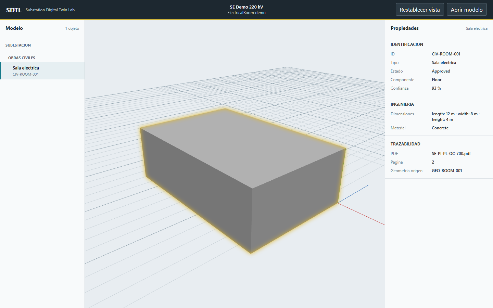

# SDTL v1.9.5 - GLTF / Babylon.js Visualization Layer

## Objetivo

Visualizar modelos `Object3D` de SDTL en una escena Babylon.js interactiva,
manteniendo seleccion, propiedades tecnicas y trazabilidad documental. La capa
frontend solo carga, navega e inspecciona; no ejecuta reglas de ingenieria.

## Arquitectura

```text
Backend                                         Frontend

Approved SDTLObject
       |
       v
Parametric Object3D
       |
       v
GLTFExporter
  buffers + accessors + metadata
       |
       +-----------------------------> ObjectLoader
                                          |
                            +-------------+-------------+
                            |                           |
                     SelectionManager               TreeView
                            |                           |
                            +-------------+-------------+
                                          |
                                   ObjectInspector
                                          |
                                    MetadataPanel
```

## Flujo glTF

`GLTFExporter` convierte vertices, normales e indices a un buffer binario
embebido en Base64. Crea `bufferViews` y `accessors` estandar, materiales PBR,
nodos y escenas glTF 2.0. Las coordenadas internas SDTL usan Z vertical; durante
la exportacion se convierten al sistema glTF con Y vertical.

El visor usa los modulos oficiales `@babylonjs/core` y `@babylonjs/loaders/glTF`.
`ObjectLoader` acepta URL, `File` `.gltf` o `.glb`, importa la escena y registra
cada mesh seleccionable.

## Metadata

El documento, nodo raiz y cada mesh contienen `extras.metadata` con:

- `sdtl_id`
- `source_pdf`
- `page`
- `source_geometry`
- `object_type`
- `state`
- `confidence`
- `dimensions`
- `material`

Los meshes agregan `component_id`, `component_name` y `mesh_id`. El visor busca
esta metadata en el mesh seleccionado y, si es necesario, recorre sus padres.

## Escena

`SceneManager` crea engine, escena, camara orbital, luces, grilla y ejes X/Y/Z.
La camara admite orbita, zoom y paneo mediante controles Babylon. La paleta de
escena se carga desde `visual_materials.json`, no desde reglas de ingenieria.

## Seleccion

`SelectionManager` escucha eventos de picking, resuelve el objeto SDTL mediante
`ObjectLoader` y resalta todos sus componentes. Emite `onObjectSelected` para
sincronizar el arbol y el inspector. Seleccionar desde `TreeView` usa el mismo
flujo, por lo que no duplica logica.

## Inspector

`ObjectInspector` coordina el estado de seleccion. `MetadataPanel` presenta tres
secciones: identificacion, ingenieria y trazabilidad. El contenido se crea con
nodos DOM y `textContent` para no interpretar metadata como HTML.

## Catalogo visual

`visual_materials.json` mapea tipos SDTL a etiqueta, categoria y material visual.
Tambien define fondo, grilla, ejes y color de seleccion. El catalogo puede crecer
sin modificar el loader ni el modelo de dominio.

## Demo

`electrical_room_demo.json` documenta la entrada civil aprobada de 12 x 8 x 4 m.
El backend genera `electrical_room_demo.gltf`, compuesto por piso, cuatro paredes
y techo. El visor lo carga al iniciar.



## Decisiones

- Backend genera geometria, metadata y glTF.
- Frontend visualiza, selecciona e inspecciona.
- La relacion mesh -> Object3D -> SDTLObject se basa en IDs, no en nombres.
- Los buffers se embeben para permitir un demo autocontenido.
- La seleccion agrupa todos los componentes del mismo objeto SDTL.
- Babylon.js no contiene logica civil, electrica ni documental.

## Limitaciones

- No es BIM y no exporta IFC.
- No incluye simulacion, SCADA ni IEC 61850.
- No contiene equipos electricos.
- La visualizacion depende de glTF/GLB.
- La metadata inicial esta orientada a ingenieria civil.
- No hay streaming, LOD, instancing ni particion espacial para escenas masivas.
- La carga local de `.gltf` solo admite recursos embebidos; modelos con archivos
  externos deben servirse mediante URL o empaquetarse como `.glb`.

## Siguiente fase

SDTL v2.0 puede implementar la `Civil Digital Twin Construction Layer`, con
componentes constructivos, secuencias y estados de avance sobre esta base trazable.
